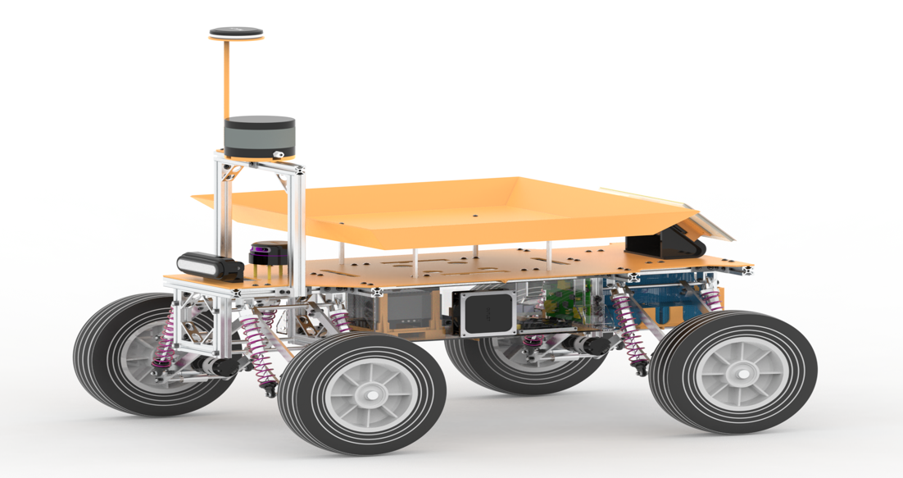
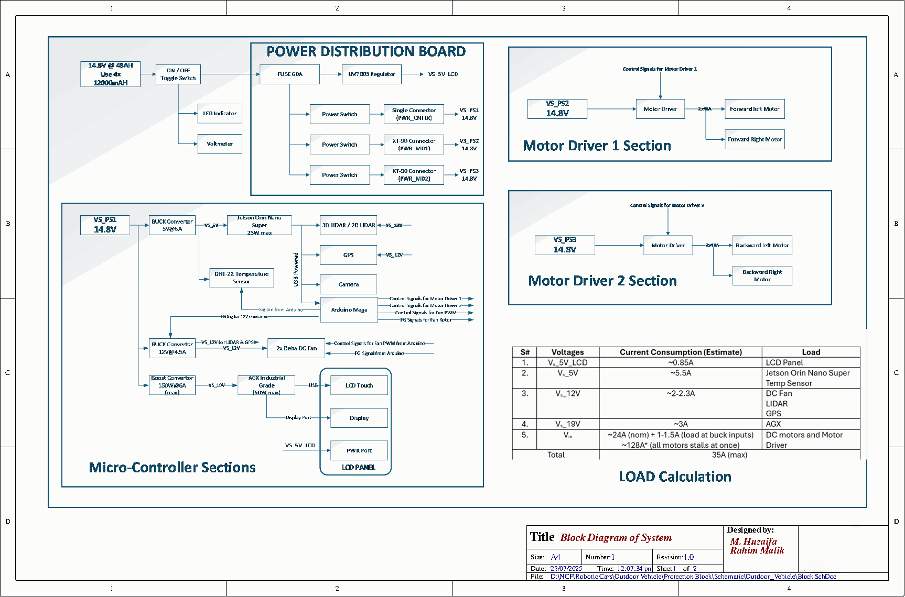
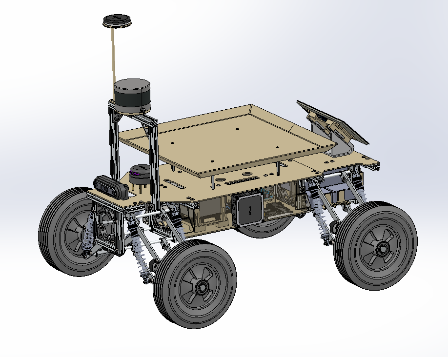
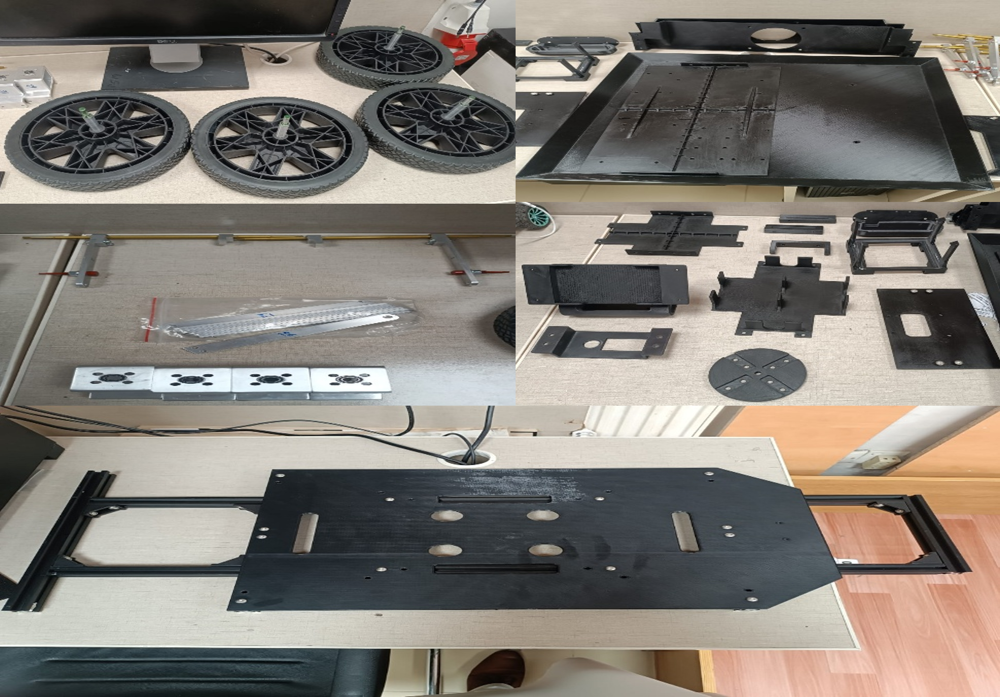
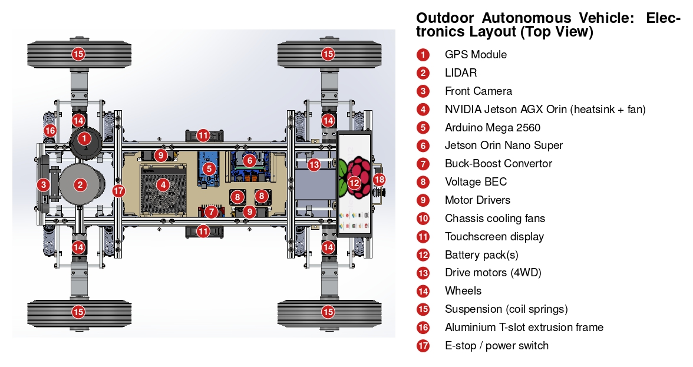
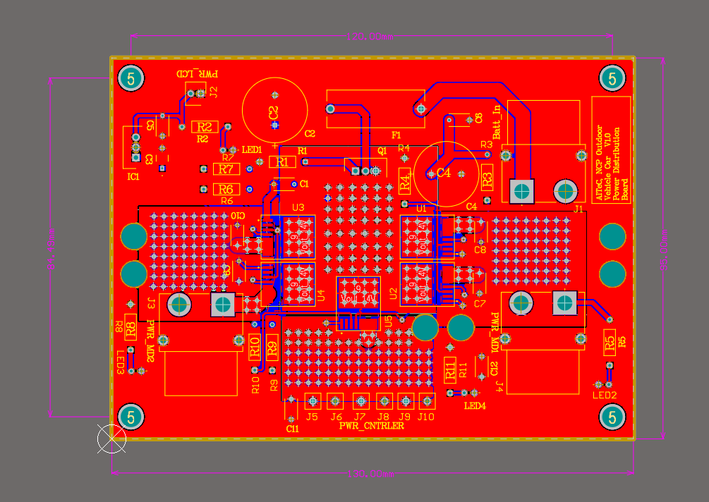
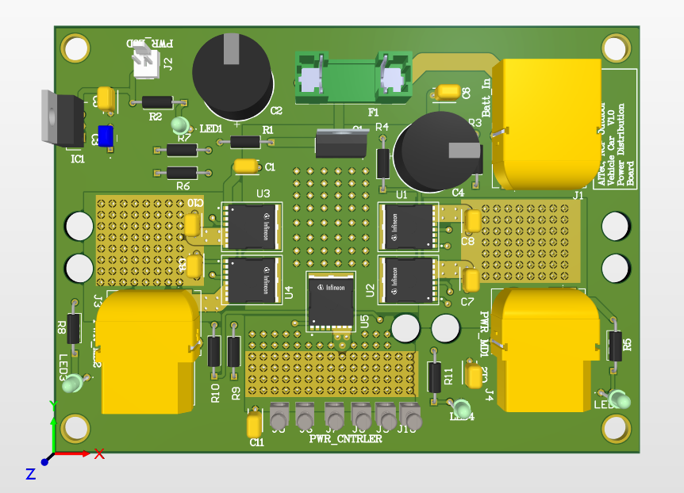
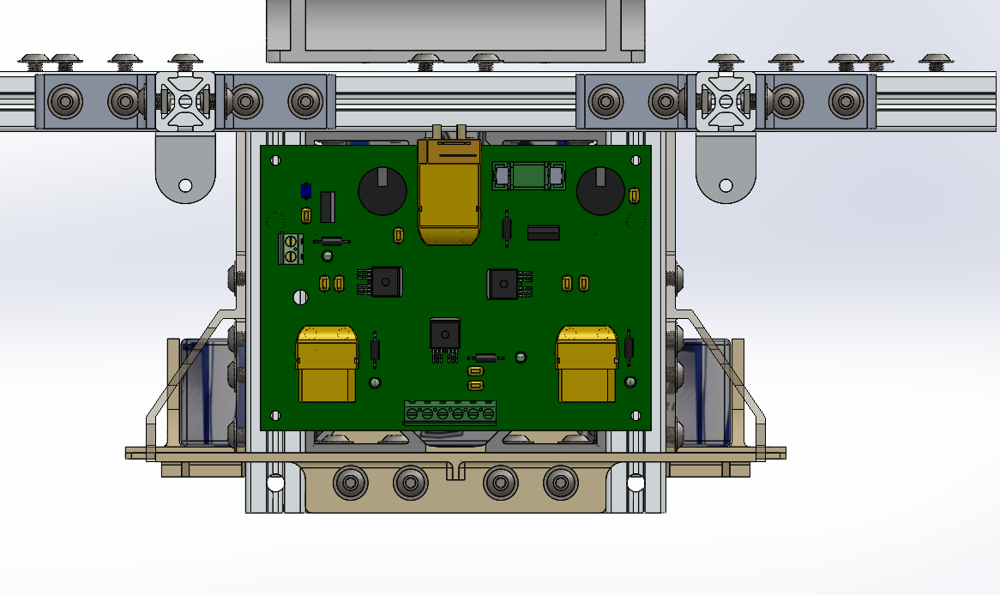

# Outdoor Autonomous Vehicle — Electrical Architecture & Power Distribution
<<<<<<< HEAD
A high-performance outdoor autonomous vehicle engineered for navigation, 3D mapping, and advanced perception. It integrates NVIDIA AGX Orin, 3D/2D LiDAR, multi-camera systems, GPS, and high-torque encoder motors with a custom power distribution system.
=======
A high-performance outdoor autonomous vehicle engineered for navigation, 3D mapping, and advanced perception. It integrates NVIDIA AGX Orin, 3D LiDAR, multi-camera systems, GPS, and high-torque encoder motors with a custom power distribution system.
>>>>>>> 5a85e198b06833bccc39082a0b41cc006285fa4e



**Features:**
- ROS 2-compatible 4WD mobile platform for outdoor applications
- Robust aluminum chassis with 10-inch solid rubber wheels
- Designed for operation on uneven outdoor terrain
- Supports custom robotic algorithm development, including navigation, SLAM, and perception

## System Overview
<<<<<<< HEAD
The vehicle is a four-wheel-drive, skid-steer (differential drive) outdoor platform built on an aluminium-extrusion chassis with independent suspension at every wheel and 10" solid, flat-free rubber tyres. Perception and compute are split across two NVIDIA Jetson modules: a Jetson Orin Nano Super that handles the sensor stack (3D/2D LiDAR, GPS, camera, DHT22 temperature/humidity sensor) and a Jetson AGX Orin 64GB for heavy navigation, SLAM and perception workloads, with a 10.4" touch display for on-vehicle monitoring. An Arduino Mega 2560 sits between the Jetson and the actuators: it generates the control signals for the two 2×40 A motor drivers (four brushed DC gear-motors with encoders) and PWM-controls the two enclosure cooling fans while reading their tach feedback.
=======
The vehicle is a four-wheel-drive, skid-steer (differential drive) outdoor platform built on an aluminium-extrusion chassis with independent suspension at every wheel and 10" solid, flat-free rubber tyres. Perception and compute are split across two NVIDIA Jetson modules: a Jetson Orin Nano Super that handles the sensor stack (3D/2D LiDAR, GPS, camera, DHT22 temperature/humidity sensor) and a Jetson AGX Orin 64GB for heavy navigation, SLAM and perception workloads, with a 10.4" touch display for on-vehicle monitoring. An Arduino Mega 2560 sits between the Jetson and the actuators: it generates the control signals for the two 2×40 A motor drivers (four brushed DC gear-motors with encoders) and PWM-controls the two enclosure cooling fans while reading their tach/PG feedback.
>>>>>>> 5a85e198b06833bccc39082a0b41cc006285fa4e

Everything runs from a single 14.8 V battery pack (4 × 4S 12 Ah LiPo in parallel, 48 Ah). The pack feeds a custom power distribution board through an XT90 connector. The board provides fusing, reverse-polarity protection and smart high-side switching, and splits power into separate rails for the compute/sensor stack and the two motor-driver sections. Downstream DC-DC converters then produce 5 V, 12 V and 19 V rails. A battery disconnect switch, panel voltmeter and indicator LED complete the power front-end.


## Specifications
| Parameter | Value |
|---|---|
| Drive | 4WD, differential (skid) steering |
| Dimensions (L × W × H) | 860 × 677 × 458 mm |
| Weight | 30 kg (platform only) |
| Payload (actual / max) | 19 kg / 22 kg |
| Wheels | 10" × 2" solid flat-free rubber, side-mount hub with ball bearing (×4) |
| Suspension | Independent; 190 mm big-bore shocks (×8) with aluminium shock mounts (×8) |
| Frame | Aluminium extrusion chassis with mounting plates and payload tray |
| Main computer | NVIDIA Jetson AGX Orin 64GB Developer Kit |
| Sensor computer | NVIDIA Jetson Orin Nano Super Developer Kit |
| Microcontroller | Arduino Mega 2560 |
| Sensors | 3D LiDAR / 2D LIDAR , RGB-D camera, GPS, DHT22 temperature/humidity |
| Motors | 4 × goBILDA 5303 Saturn planetary gear motor  |
| Motor drivers | 2 × goBILDA 2×40 A (9–30 V, 50 A burst) |
| Battery | 14.8 V, 48 Ah (4 × Zeee 4S 12000 mAh, XT90) |
| Display | Waveshare 10.4" QLED capacitive touch, HDMI |
| Cooling | 2 × Delta AFC0912D 92 mm fans with filters |
| Software | ROS 2 compatible |
### Power budget
| Rail | Estimated current | Load |
|---|---|---|
| 5 V (LCD) | ~0.85 A | LCD panel |
| 5 V | ~5.5 A | Jetson Orin Nano Super, DHT22 |
| 12 V | ~2–2.3 A | Fans, LiDAR, GPS |
| 19 V | ~3 A | Jetson AGX Orin |
| Battery (motors) | ~24 A nominal, ~128 A if all motors stall | Motors and drivers |
| **Total** | **35 A (max, excluding stall)** | |

## Hardware Design
### Mechanical
The chassis is built from aluminium extrusion with a central electronics bay, front and rear axle assemblies and a payload tray above. Each wheel hangs on its own arm with a damper, giving independent suspension for uneven ground. The CAD renders show the tall sensor mast at the front carrying the 3D LiDAR with the GPS antenna above it, a forward camera, and the touch display mounted at the rear. The build photos show the chassis plates, payload tray and sensor/electronics brackets as black parts alongside the wheels, shocks and mounting hardware.




### Electrical architecture
The 4WD Outdoor vehicle divides the system into four sections:
1. Power distribution board. Battery (14.8 V, 48 Ah) → on/off toggle switch (with LED indicator and voltmeter) → 60 A fuse → smart power switches feeding three supplies: VS_PS1 (compute/sensor stack), VS_PS2 (motor driver 1) and VS_PS3 (motor driver 2). An LM7805 provides the 5 V rail for the LCD.
2. Microcontroller / compute section (VS_PS1):
- A 6 A, 5 V BEC powers the Jetson Orin Nano Super, which connects over USB to the 3D/2D LiDAR, GPS, camera and the Arduino Mega.
- A 12 V, 4.5 A buck converter powers the LiDAR, GPS and the two fans.
- A 150 W boost converter produces 19 V for the AGX Orin, which drives the touch display (HDMI video, USB touch).
3. Motor driver 1 (VS_PS2). Drives the two forward motors (left and right).
4. Motor driver 2 (VS_PS3). Drives the two rear motors (left and right).

<<<<<<< HEAD

=======
>>>>>>> 5a85e198b06833bccc39082a0b41cc006285fa4e
### Power distribution & protection board (Altium)
The custom board sits between the battery and everything else as the single point of power protection and distribution.
- **Input:** XT90PW connector (J1) with 470 µF bulk capacitors on the input.
- **Fusing:** PCB cartridge fuse block (F1, Littelfuse 0PTF0078P).
- **Reverse-polarity protection:** P-channel MOSFET Q1 (IRF4905PBF, 55 V / 74 A).
- **Output switching:** five Infineon BTS50005-1LUA smart high-side switches (U1–U5, 3.1–28 V, 65 A class), with green status LEDs.
- **Outputs:** two XT90 female outputs (J3, J4) and six binding-post terminals (J5–J10), plus a 2-pin header (J2).
- **Regulation:** LM7805 linear regulator (IC1) for the 5 V logic/LCD rail.
- **Dimension:** (130 x 95)mm [L x W]







The protection circuit was simulated in NI Multisim `(Protection Block/Simulation/Protection Circuit.ms14)`.
## Repository Structure
```
hardware/altium/   Altium project — block diagram & power-distribution schematics, PCB layout, schematic/PCB libraries, 3D PCB model (.step)
docs/              Schematic PDF export, BOM
images/            Schematic render for this README
```
## Hardware Design
Designed in Altium Designer (`hardware/altium/`):
- `Block.SchDoc` — system-level block diagram
- `Power Distribution Block.SchDoc` — detailed protection/regulation circuit
- `final_PCB.PcbDoc` / `final_PCB_SmartPCB.PcbDoc` — PCB layout with `final_PCB.step` as the 3D model
- `Schlib1.SchLib` / `PcbLib1.PcbLib` — custom schematic and footprint libraries used in the design
Full schematic export and the bill of materials are in `docs/` 

## Author
Project team: Dr.Muhammad Ahmad Kamran (Team Lead) ,Muhammad Huzaifa Rahim Malik (Electronics Design), Muhammad Mohsin Razaqi (Mechanical Design), Muhammad Awais Khan (Algorithm Design)
