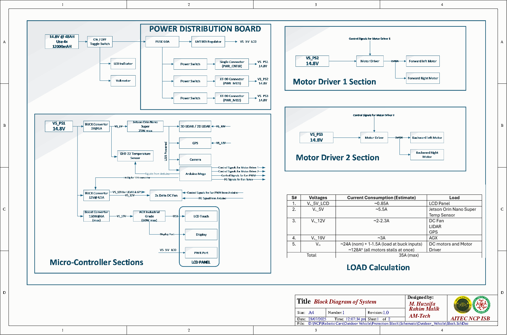

# Outdoor Vehicle — Power Distribution & Protection Board

PCB design for the power distribution and battery-protection subsystem of an outdoor autonomous ground vehicle, built around Jetson/Arduino compute and multiple sensor/actuator rails.



## Overview

The board takes a single battery input through an **XT90PW** connector and provides fused, MOSFET-switched, reverse-polarity-protected power to the rest of the vehicle, with onboard regulation down to the 5V rail used by logic and peripherals. It was designed to sit between the battery and the vehicle's compute/sensor stack (Jetson Orin Nano / AGX, Arduino Mega) as the single point of power protection and distribution.

**Protection & regulation:**
- Input fusing (`F1`) and a P-MOSFET (`IRF4905PBF`) battery-protection/reverse-polarity stage
- Linear regulation (`LM7805`) for the 5V logic rail, alongside the 14V input rail
- Designed across two schematic sheets — system block diagram and the power-distribution circuit itself

**Target compute/sensor stack** (per the component sourcing list in `docs/Components_Link_List.*`): Arduino Mega, Jetson AGX Orin / Jetson Orin Nano Super, plus fan + filter for thermal management, DHT22 temperature sensing, voltmeter, LCD status display, rocker disconnect switch, and dedicated voltage regulators/boost converters for the Jetson rails.

## Repository Structure

```
hardware/altium/   Altium project — block diagram & power-distribution schematics, PCB layout, schematic/PCB libraries, 3D PCB model (.step)
docs/              Schematic PDF export, BOM, Design Rule Check report, block diagram source, sourced-component link list
images/            Schematic render for this README
```

## Hardware Design

Designed in Altium Designer (`hardware/altium/`):
- `Block.SchDoc` — system-level block diagram
- `Power Distribution Block.SchDoc` — detailed protection/regulation circuit
- `final_PCB.PcbDoc` / `final_PCB_SmartPCB.PcbDoc` — PCB layout (two output variants), with `final_PCB.step` as the 3D model
- `Schlib1.SchLib` / `PcbLib1.PcbLib` — custom schematic and footprint libraries used in the design

Full schematic export and the bill of materials are in `docs/` for quick viewing without Altium installed; `docs/Design_Rule_Check.html` documents the PCB's DRC pass.

## Notes

Third-party component library packages (multi-CAD vendor downloads for footprints/symbols — Allegro, KiCad, Eagle, Proteus, etc.) were left out of this repo since they're vendor-supplied reference files rather than original design work; only the Altium library files actually used in the design are included.

## Author

Muhammad Huzaifa Rahim Malik — AITEC NCP, Islamabad.
